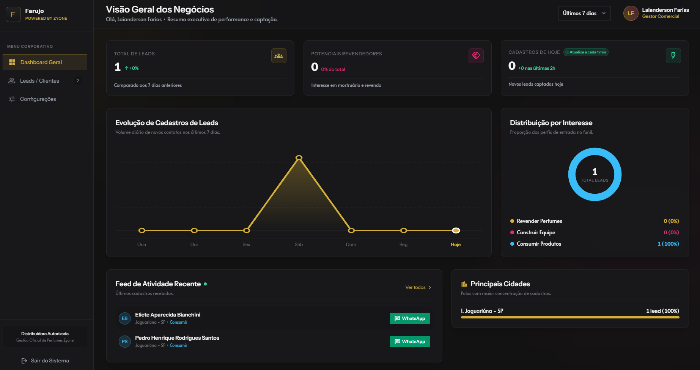
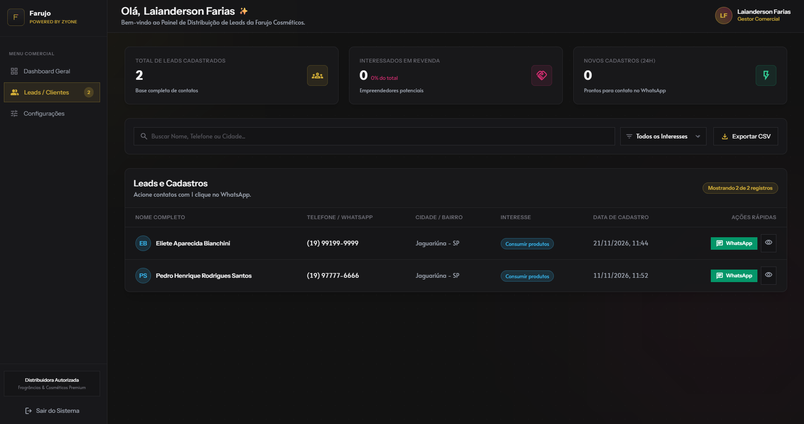
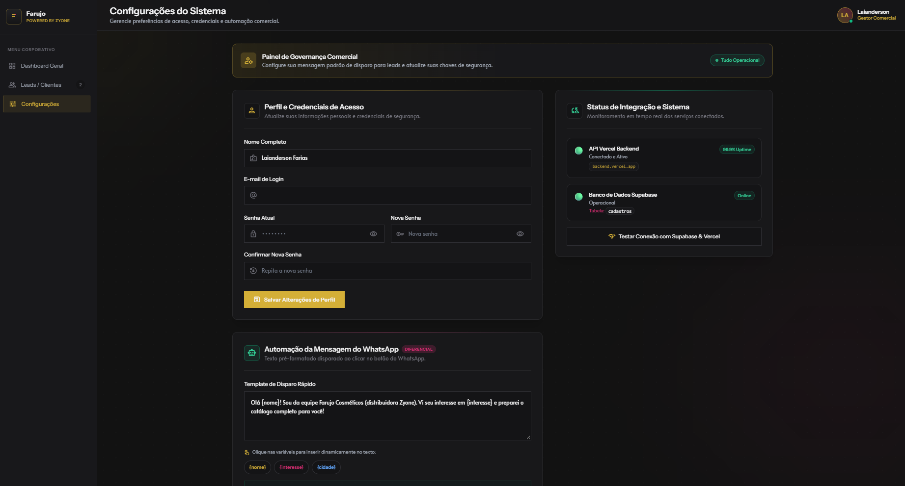

  

  # Painel de Gestão Comercial

  **Farujo Cosméticos · Distribuidora autorizada Zyone**

  Acompanhe indicadores, organize contatos interessados e agilize o atendimento comercial em um único painel.

 

## Sobre o projeto

O Painel de Gestão Comercial da Farujo Cosméticos é uma interface web para apoiar o acompanhamento de resultados e a gestão de leads. Ele apresenta dados de cadastros e interesses, facilita a consulta aos contatos e permite preparar mensagens personalizadas para iniciar conversas pelo WhatsApp.

O sistema é composto por páginas HTML que se comunicam com uma API remota para autenticação e acesso aos dados. A API está hospedada separadamente deste repositório.

## Funcionalidades

- **Visão geral:** resumo dos leads, novos cadastros, evolução ao longo do período, interesses mais frequentes, atividade recente e cidades com maior concentração.
- **Leads e clientes:** pesquisa por nome, telefone ou cidade; filtro por interesse; visualização de detalhes; exportação dos registros em CSV; atalho para contato pelo WhatsApp.
- **Configurações:** edição de perfil e credenciais, personalização do modelo de mensagem do WhatsApp com variáveis e consulta ao status dos serviços conectados.
- **Acesso:** autenticação do usuário e manutenção da sessão no navegador, com opção de lembrar o acesso.

## Telas

### Visão geral

Indicadores e atividade comercial.

### Leads e clientes

Pesquisa, consulta e contato com leads.

### Configurações

Perfil, integrações e mensagem do WhatsApp.

## Estrutura do projeto

| Arquivo ou pasta | Descrição |
| --- | --- |
| `login.html` | Tela de acesso ao painel. |
| `index.html` | Dashboard com indicadores e atividade comercial. |
| `leads.html` | Consulta e gerenciamento de leads e clientes. |
| `configuracoes.html` | Perfil, mensagem de WhatsApp e diagnóstico das integrações. |
| `logo.png` | Logotipo utilizado pela interface. |
| `docs/screenshots/` | Capturas das principais telas incluídas neste README. |

## Tecnologias e integrações

- **Interface:** HTML, CSS utilitário via Tailwind CSS CDN e JavaScript no próprio HTML.
- **Serviços externos da interface:** Google Fonts e Material Symbols para tipografia e ícones.
- **API:** `https://zyone-backend.vercel.app`, usada para autenticação, dashboard, leads, configurações e diagnóstico.
- **Serviços indicados pelo painel:** backend na Vercel e banco de dados Supabase.

Este repositório contém a interface web. O código da API e a configuração do banco de dados não estão incluídos nele. As páginas autenticadas dependem da disponibilidade da API e dos serviços de terceiros usados para carregar estilos, fontes e ícones.

## Acesso

Abra `login.html` em um navegador para acessar a tela de login. Para usar as áreas autenticadas, é necessário ter credenciais válidas e conexão com a API configurada no sistema.
